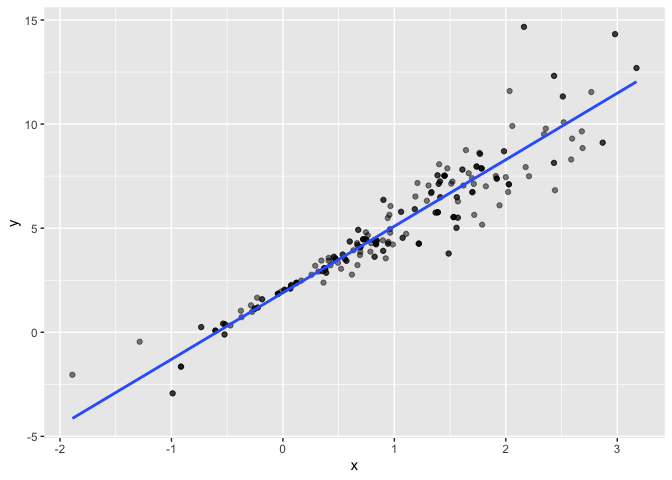
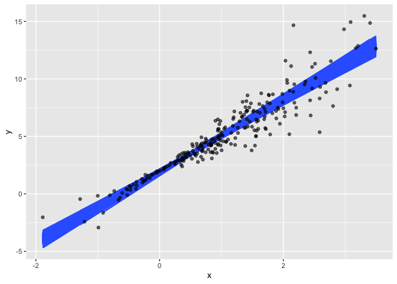
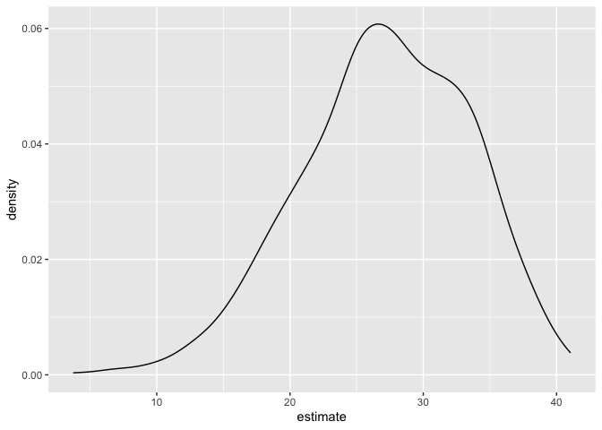
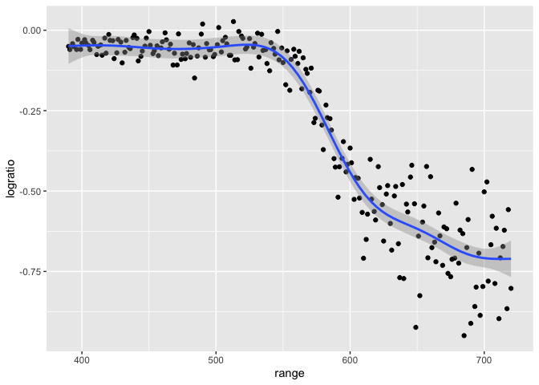
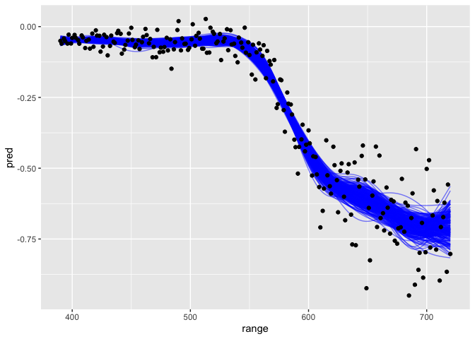

bootstrapping
================
Emma
2026-11-19

``` r
library(tidyverse)
```

    ## ── Attaching core tidyverse packages ──────────────────────── tidyverse 2.0.0 ──
    ## ✔ dplyr     1.2.1     ✔ readr     2.2.0
    ## ✔ forcats   1.0.1     ✔ stringr   1.6.0
    ## ✔ ggplot2   4.0.3     ✔ tibble    3.3.1
    ## ✔ lubridate 1.9.5     ✔ tidyr     1.3.2
    ## ✔ purrr     1.2.2     
    ## ── Conflicts ────────────────────────────────────────── tidyverse_conflicts() ──
    ## ✖ dplyr::filter() masks stats::filter()
    ## ✖ dplyr::lag()    masks stats::lag()
    ## ℹ Use the conflicted package (<http://conflicted.r-lib.org/>) to force all conflicts to become errors

``` r
library(mgcv)
```

    ## Loading required package: nlme
    ## 
    ## Attaching package: 'nlme'
    ## 
    ## The following object is masked from 'package:dplyr':
    ## 
    ##     collapse
    ## 
    ## This is mgcv 1.9-4. For overview type '?mgcv'.

``` r
library(modelr)
library(p8105.datasets)

set.seed(1)
```

``` r
n_samp = 250

sim_df_const = 
  tibble(
    x = rnorm(n_samp, 1, 1),
    error = rnorm(n_samp, 0, 1),
    y = 2 + 3 * x + error
  )

sim_df_const |> 
  ggplot(aes(x = x, y = y)) +
  geom_point() +
  geom_smooth()
```

    ## `geom_smooth()` using method = 'loess' and formula = 'y ~ x'

<!-- -->

``` r
sim_df_nonconst = 
  sim_df_const |> 
  mutate(
    error = error * .75 * x, #outcome variance depends on the predictor now (because x). this leads to nonconstant variance
    y = 2 + 3 * x + error 
  )

sim_df_nonconst |> 
  ggplot(aes(x = x, y = y)) +
  geom_point() +
  geom_smooth(method = "lm") #CI should be much bigger at tails where there is large variance - fix this 
```

    ## `geom_smooth()` using formula = 'y ~ x'

<!-- -->

Fix the regressions

``` r
sim_df_const |> 
  lm(y ~ x, data = _) |> 
  broom::tidy() |> 
  knitr::kable(digits = 3)
```

| term        | estimate | std.error | statistic | p.value |
|:------------|---------:|----------:|----------:|--------:|
| (Intercept) |    1.977 |     0.098 |    20.157 |       0 |
| x           |    3.045 |     0.070 |    43.537 |       0 |

Nonconstant

``` r
sim_df_nonconst |> 
  lm(y ~ x, data = _) |> 
  broom::tidy() |> 
  knitr::kable(digits = 3)
```

| term        | estimate | std.error | statistic | p.value |
|:------------|---------:|----------:|----------:|--------:|
| (Intercept) |    1.934 |     0.105 |    18.456 |       0 |
| x           |    3.112 |     0.075 |    41.661 |       0 |

Let’s try to get a CI for this dataset that we trust a bit more.

\#Draw a bootstrap sample

Let’s always write a little function

``` r
draw_boot_sample = function(df) {
  
  sample_frac(df, replace = TRUE)
  
}
```

Does this work?

``` r
sim_df_nonconst |> 
  draw_boot_sample() |> 
  ggplot(aes(x = x, y = y)) +
  geom_point(alpha = 0.5) +
  geom_smooth(method = "lm", se = FALSE)
```

    ## `geom_smooth()` using formula = 'y ~ x'

<!-- -->
Re-running –\> slightly different datasets each time Generate 1000
bootstrap samples and 1000 regressions and take the results

Draw a bunch of samples and analyze

``` r
boot_straps = 
  tibble(
    strap_number = 1:1000
  ) |> 
  mutate(
    strap_sample = map(strap_number, \(i) draw_boot_sample (sim_df_nonconst))
  )
```

``` r
boot_strap_df = 
  tibble(
    strap_number = 1:1000
  ) |> 
  mutate(
    strap_sample = map(strap_number, \(i) draw_boot_sample (sim_df_nonconst)), 
    model_fit = map(strap_sample, \(df) lm(y ~ x, data = df)), 
    results = map(model_fit, broom::tidy)
  ) 
```

Did this work?

``` r
boot_strap_df |> 
  select(strap_number, results) |> 
  unnest(results) |> 
  group_by(term) |> 
  summarize(
    mean_est = mean(estimate), 
    se_est = sd(estimate)
  )
```

    ## # A tibble: 2 × 3
    ##   term        mean_est se_est
    ##   <chr>          <dbl>  <dbl>
    ## 1 (Intercept)     1.93 0.0762
    ## 2 x               3.11 0.104

Estimates are about the same as OG dataset, but SE is different (bigger
for slope, lower for intercept)

Look at the results more

``` r
boot_strap_df |> 
  select(strap_number, strap_sample) |> 
  unnest(strap_sample) |> 
  ggplot(aes(x = x, y = y, group = strap_number)) +
  geom_smooth(method = "lm", se = FALSE, alpha = .3) +
  geom_point(data = sim_df_nonconst, aes(group = NULL), alpha = .6)
```

    ## `geom_smooth()` using formula = 'y ~ x'

<!-- -->

Quick notes

``` r
boot_straps = 
  sim_df_nonconst |> 
  modelr::bootstrap(n = 1000)
```

What about bootstrapping in a dataset when we trust the assumptions?

``` r
boot_strap_df_constant = 
  tibble(
    strap_number = 1:1000
  ) |> 
  mutate(
    strap_sample = map(strap_number, \(i) draw_boot_sample (sim_df_const)), 
    model_fit = map(strap_sample, \(df) lm(y ~ x, data = df)), 
    results = map(model_fit, broom::tidy)
  ) 
```

This gives you the same assumptions as the OG dataset (which is good
because we trust those assumptions!) - it will give you the right answer

## Airbnb

``` r
data("nyc_airbnb")

nyc_airbnb = 
  nyc_airbnb |> 
  mutate(
    stars = review_scores_location / 2
  ) |> 
  rename(
    borough = neighbourhood_group, 
    neighborhood = neighbourhood
  ) |> 
  filter(borough != "Staten Island") |> 
  drop_na(price, stars) |> 
  select(price, stars, borough, neighborhood, room_type)
```

this doesn’t look good:

``` r
nyc_airbnb |> 
  ggplot(aes(x = stars, y = price, color = room_type)) +
  geom_point()
```

<!-- -->
Skewed data, if we fit a linear regression model to this, I dont know if
I’d trust it

Bootstrap

``` r
airbnb_bootstrap_df = 
  nyc_airbnb |> 
  filter(borough == "Manhattan") |> 
  modelr::bootstrap(n = 1000) |> 
  mutate( #jumping to results 
    model_fits = map(strap, \(df) lm (price ~ stars + room_type, data = df)), 
    results = map(model_fits, broom::tidy)
  )
```

are these coefficients close enough to normal that I can trust default
inference?

``` r
airbnb_bootstrap_df |> 
  select(results) |> 
  unnest(results)
```

    ## # A tibble: 4,000 × 5
    ##    term                  estimate std.error statistic   p.value
    ##    <chr>                    <dbl>     <dbl>     <dbl>     <dbl>
    ##  1 (Intercept)              127.      25.1       5.05 4.48e-  7
    ##  2 stars                     20.2      5.18      3.90 9.83e-  5
    ##  3 room_typePrivate room   -117.       3.92    -29.8  6.07e-189
    ##  4 room_typeShared room    -149.      11.6     -12.9  8.89e- 38
    ##  5 (Intercept)               91.9     23.3       3.95 7.84e-  5
    ##  6 stars                     28.6      4.81      5.94 2.84e-  9
    ##  7 room_typePrivate room   -128.       3.58    -35.7  8.00e-268
    ##  8 room_typeShared room    -156.      10.1     -15.4  4.52e- 53
    ##  9 (Intercept)               63.3     17.8       3.55 3.86e-  4
    ## 10 stars                     33.8      3.68      9.18 5.02e- 20
    ## # ℹ 3,990 more rows

``` r
airbnb_bootstrap_df |> 
  select(results) |> 
  unnest(results) |> 
  filter(term == "stars") |> 
  ggplot(aes(x = estimate)) + 
  geom_density()
```

<!-- --> Does
not look super symmetric

CI for stars slope:

``` r
airbnb_bootstrap_df |> 
  select(results) |> 
  unnest(results) |> 
  filter(term == "stars") |> 
  summarize(
    slope_estimate = mean(estimate), 
    ci_lb = quantile(estimate, 0.025),
    ci_ub = quantile(estimate, 0.975)
  )
```

    ## # A tibble: 1 × 3
    ##   slope_estimate ci_lb ci_ub
    ##            <dbl> <dbl> <dbl>
    ## 1           27.2  14.0  38.1

# LIDAR

``` r
data("lidar")

lidar |> 
  ggplot(aes(x = range, y = logratio)) + 
  geom_point() + 
    stat_smooth(method = "gam", formula = y ~ s(x))
```

<!-- -->

``` r
lidar |> 
  modelr::bootstrap(n = 250) |> 
  mutate(
    models = map(strap, \(df) gam(logratio ~ s(range), data = df)),
    results = map(models, \(mod) modelr::add_predictions(data = lidar, model = mod))) |> 
  select(.id, results) |> 
  unnest(results) |> 
  ggplot(aes(x = range, y = pred, group = .id)) + 
  geom_path(color = "blue", alpha = .5) + 
  geom_point(data = lidar, aes(y = logratio, group = NULL))
```

<!-- -->
