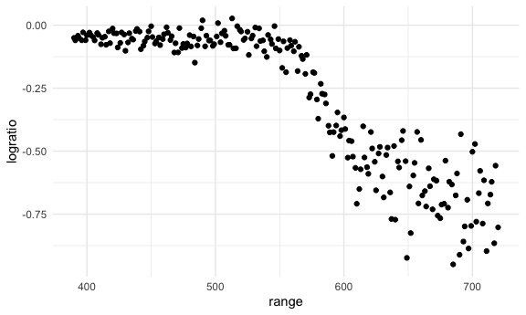
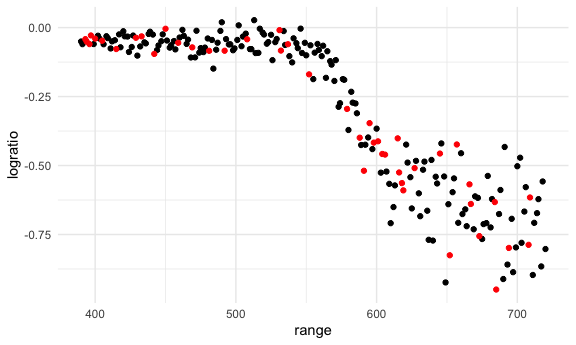
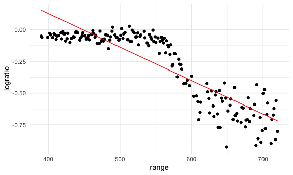
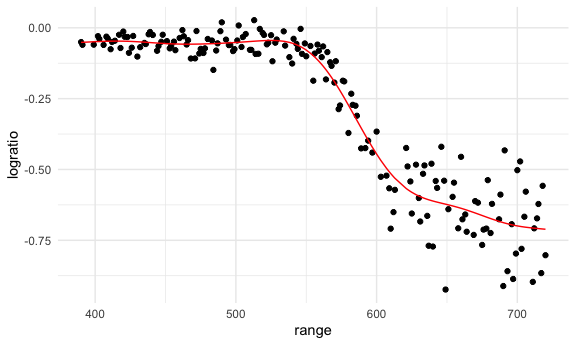
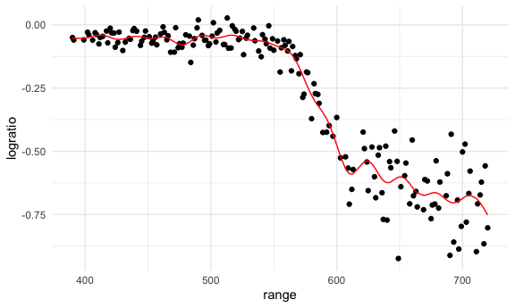
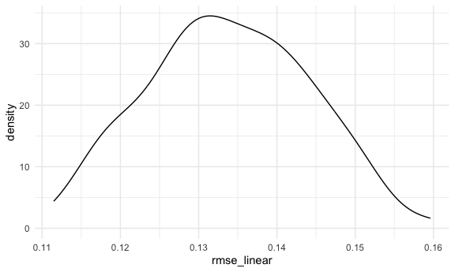
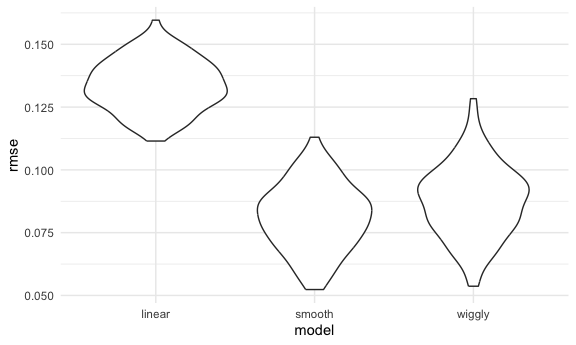

cross_validation
================
Emma
2026-11-17

## Model selection

when you have lots of possible variables, you have to choose which will
go in your model

remember, no model is “true”

In nested models, you have tests

- you have to be worried about multiple comparisons and “fishing”

In non-nested models, you don’t have tests

- balance goodness of fit with “complexity”

Is your model too complex? Not complex enough? Am I underfiting or
overfitting? Do I have high bias or high variance? Will my model
generalize to future datasets?

## Cross validation

Ideally, you’d build your model based off a data set and then collect
more data from same population to test that the model works. That
doesn’t usually happen, so instead:

randomly split your data into “training” and “testing”

- “training” data used to build your model
- “testing” data used to evaluate out of sample fit
- exact ratio depends, but 80/20 is a good bet

Evaluate using root mean squared error in the testing dataset –\> low
RMSE is indicative of good prediction accuracy (because predicted value
is close to observed value, so low number)

Can use to compare candidate models that are all “traditional”

Comes up a lot in “modern” methods - often built in so you don’t even
see it

## Refinements and variations

Usually repeat the training/testing split using iteration –\> indicates
whether differences in models are consistent across splits

Folding partitions data into equally sized subsets

- one fold used as testing, remaining folds as training
- repeated for each fold as testing

Jeff doesn’t do that as often

## Prediction as a goal

Prediction accuracy matters as well as statistical significance
(different goal)

- Good models make good predictions that adequately describe the data
  generating mechanism
- you lose the p values though

Use `modelr` package. functions: `add_predictions()`, `add_residuals()`,
`rmse()`, `crossv_mc()`

``` r
library(tidyverse)
```

    ## ── Attaching core tidyverse packages ──────────────────────── tidyverse 2.0.0 ──
    ## ✔ dplyr     1.2.1     ✔ readr     2.2.0
    ## ✔ forcats   1.0.1     ✔ stringr   1.6.0
    ## ✔ ggplot2   4.0.3     ✔ tibble    3.3.1
    ## ✔ lubridate 1.9.5     ✔ tidyr     1.3.2
    ## ✔ purrr     1.2.2     
    ## ── Conflicts ────────────────────────────────────────── tidyverse_conflicts() ──
    ## ✖ dplyr::filter() masks stats::filter()
    ## ✖ dplyr::lag()    masks stats::lag()
    ## ℹ Use the conflicted package (<http://conflicted.r-lib.org/>) to force all conflicts to become errors

``` r
library(modelr)
library(mgcv)
```

    ## Loading required package: nlme
    ## 
    ## Attaching package: 'nlme'
    ## 
    ## The following object is masked from 'package:dplyr':
    ## 
    ##     collapse
    ## 
    ## This is mgcv 1.9-4. For overview type '?mgcv'.

``` r
library(p8105.datasets)

set.seed(1)
```

``` r
knitr::opts_chunk$set(
  fig.width = 6,
  fig.asp = .6,
  out.width = "90%"
)

theme_set(theme_minimal() + theme(legend.position = "bottom"))

options(
  ggplot2.continuous.colour = "viridis",
  ggplot2.continuous.fill = "viridis"
)

scale_colour_discrete = scale_colour_viridis_d
scale_fill_discrete = scale_fill_viridis_d
```

# CV by hand

## LIDAR data

``` r
data("lidar")

lidar_df = 
  lidar |> 
  mutate(
    id = row_number()
  ) |> 
  select(id, everything())

lidar_df |> 
  ggplot(aes(x = range, y = logratio)) +
  geom_point()
```


Can’t use linear regression here - nonlinear! You have to get that
non-linearity right. You also can’t assume constant variance, it changes
across the range. Need to capture that as well

## Build three models, see which works the best using CV.

First, build training and testing datasets.

``` r
train_df = sample_frac(lidar_df, size = .8) #80% of data for training 

test_df = anti_join(lidar_df, train_df, by = "id") #this gives you leftover bit, this is why you have to add row number/id
```

``` r
ggplot(train_df, aes(x = range, y = logratio)) +
  geom_point() +
  geom_point(data = test_df, color = "red")
```


Looks pretty representative of OG graph, but thinner (20% of data
randomly sampled out). The red points added on top show testing dataset

Fit some models

Linear model (this won’t work well)

``` r
linear_mod = lm(logratio ~ range, data = train_df)
```

Make a plot

``` r
train_df |> 
  add_predictions(linear_mod) |> #adds column of predictions to dataset
  ggplot(aes(x = range, y = logratio)) +
  geom_point() +
  geom_line(aes(y = pred), color = "red") #adds line fitted to prediction variable 
```


Bad model! Not complex enough (just a straight line when we clearly need
non-linearity) and it’s underfitted/high bias

Try a different model - smooth fit

``` r
smooth_mod = gam(logratio ~ s(range), data = train_df) #generative additive model, fits log ratio against smooth function of range. Does assume constant variance, doesn't take that into account - we will fix that when we do bootstrapping 
```

``` r
train_df |> 
  add_predictions(smooth_mod) |> 
  ggplot(aes(x = range, y = logratio)) +
  geom_point() +
  geom_line(aes(y = pred), color = "red") 
```


Looks pretty good - not a ton of bias, fits trend well

Break this function - making it bad to prove a point (don’t do this)

``` r
wiggly_mod = gam(logratio ~ s(range, k = 30), sp = 10e-6, data = train_df)
```

``` r
train_df |> 
  add_predictions(wiggly_mod) |> 
  ggplot(aes(x = range, y = logratio)) +
  geom_point() +
  geom_line(aes(y = pred), color = "red") 
```


Extra bumps - we probably don’t actually need that. probably unbiased,
but it will probably change a lot between datasets - high variability
and we don’t want that.

Do a model comparison

Can’t do a hypothesis test (because these are unnested models)

``` r
rmse(linear_mod, test_df) #relatively high prediction error 
```

    ## [1] 0.127317

``` r
rmse(smooth_mod, test_df) #much lower prediction error - the best model 
```

    ## [1] 0.08302008

``` r
rmse(wiggly_mod, test_df)
```

    ## [1] 0.08848557

# CV using `modelr`

AKA repeat the above a bunch of times

``` r
cv_df = 
  crossv_mc(lidar_df, 100) #plug in df, repeat 100 times. automatically makes training and testing datasets (in 80/20 split), repeats that 100 times. stores all the data in list columns 

cv_df |> 
  pull(train) |> 
  nth(2) |>  #confirm that there is a different 80/20 split every time 
  as_tibble() #can convert to a df anytime 
```

    ## # A tibble: 176 × 3
    ##       id range logratio
    ##    <int> <dbl>    <dbl>
    ##  1     1   390  -0.0504
    ##  2     3   393  -0.0419
    ##  3     4   394  -0.0510
    ##  4     5   396  -0.0599
    ##  5     6   397  -0.0284
    ##  6     7   399  -0.0596
    ##  7     8   400  -0.0399
    ##  8     9   402  -0.0294
    ##  9    10   403  -0.0395
    ## 10    11   405  -0.0476
    ## # ℹ 166 more rows

``` r
cv_df = 
  crossv_mc(lidar_df, 100) |> 
  mutate(
    train = map(train, as_tibble), 
    test = map(test, as_tibble)
  )
```

Let’s fit models and get rmses for these

``` r
rmse_comp = function(model, dataset){
  
  rmse(model, dataset)
  
}
```

``` r
cv_df = #apply linear mod to every training dataset, and get rmse for every testing dataset
  cv_df |> 
  mutate(
    linear_fit = map(train, \(df) lm(logratio ~ range, data = df)) #anonymous function - get training df, call it df, fit this linear model to it 
  ) |> 
  mutate(
    rmse_linear = map2(linear_fit, test, rmse_comp) #map across two things (linear model across testing dataset, get rmse)
  )
```

Could also skip function and just use rmse to simplify it

``` r
cv_df =
  cv_df |> 
  mutate(
    linear_fit = map(train, \(df) lm(logratio ~ range, data = df)),
    smooth_fit = map(train, \(df) gam(logratio ~ s(range), data = df)), 
    wiggly_fit = map(train, \(df) gam(logratio ~ s(range, k = 30), sp = 10e-6, data = df))
  ) |> 
  mutate(
    rmse_linear = map2_dbl(linear_fit, test, rmse), 
    rmse_smooth = map2_dbl(smooth_fit, test, rmse), 
    rmse_wiggly = map2_dbl(wiggly_fit, test, rmse)
  )
```

``` r
cv_df |> 
  ggplot(aes(x = rmse_linear)) +
  geom_density()
```



Do some data tidying

``` r
cv_df |> 
  select(starts_with("rmse_")) |> 
  pivot_longer(
    everything(), 
    names_to = "model",
    names_prefix = "rmse_", 
    values_to = "rmse"
  ) |> 
  ggplot(aes(x = model, y = rmse)) +
  geom_violin()
```


Shows that smooth usually works better, and there is less variance
